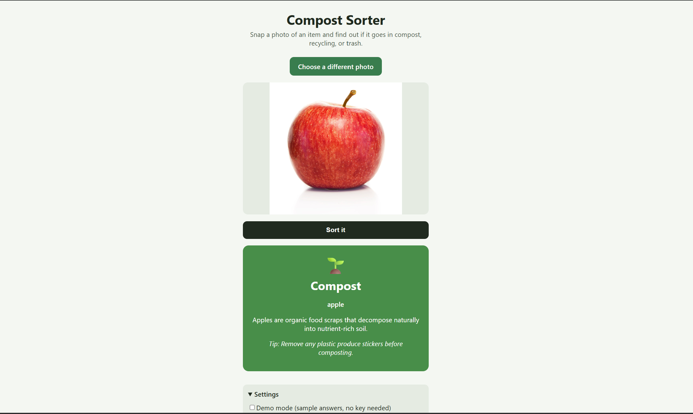

# Compost Sorter

Take a photo of an item and find out whether it goes in **compost**, **recycling**, or **trash**.

**Live demo:** (https://compost-sorter-5c2i3k12w-milan-djurcic.vercel.app/)



## What it does

1. You take or choose a photo of an item.
2. The app sends the photo to Google's Gemini API.
3. Gemini returns the item name, the category, a one-sentence reason, and a practical tip (for example, "rinse it first").
4. The app shows the answer on a color-coded card.

## Try it

- **Demo mode** (on by default): shows sample answers so you can see the interface without a key. It does not analyze your photo.
- **Real mode:** open **Settings**, paste your own free Gemini API key from [Google AI Studio](https://aistudio.google.com/), and sort real items.

Your key is stored only in your browser (`localStorage`) and is sent only to Google's API. It is never saved in this repository.

## Run it locally

```bash
git clone https://github.com/mdjur1/compost-sorter.git
cd compost-sorter
npm install
npm run dev
```

Then open the address it prints (usually http://localhost:5173).

## How it works

- **React + Vite** for the interface.
- `src/services/geminiService.js` shrinks the photo, converts it to base64, sends it to the Gemini `generateContent` endpoint with a prompt that asks for JSON, validates the response, and turns errors into readable messages.
- Photos are resized to at most 1024px before sending. Full-size phone photos made requests slow enough to time out.
- During testing I hit `503` (model busy) responses, so the service tries up to three Gemini models in order, moving on if one is busy or too slow.
- `src/components/` holds the upload preview, the result card, and the settings panel. `App.jsx` holds the state and connects them.

## Testing and known limits

I tried 6 items on my phone: an apple, a blurry photo of an apple, a chip bag, a pack of gum, an empty floor, and AirPods.

- Correct: apple (compost), chip bag (trash), and pack of gum (trash).
- It still identified the apple in the blurry photo.
- For the empty floor it answered "trash" and said no clear item was visible, instead of inventing one.
- It labeled AirPods (a charging case) as trash. Electronics are e-waste and shouldn't go in regular trash, so a three-category sorter is wrong for them.
- Sorting rules differ by city, so the model uses common US guidelines. It can be wrong for your local program.
- Demo mode returns random sample answers and does not look at your photo.
- The key lives in the browser because the app has no backend. A production version should send requests through a server so keys are never exposed.

## What I'd improve

- A fourth "e-waste / special drop-off" category for batteries and electronics
- A small backend so users don't need their own key
- Letting the user pick their city to follow local rules
- Showing how confident the model is
- A history of recent sorts

## How I built it

I built this as a small project for [Boisei Labs] to practice calling a vision API from a React app. I used AI tools (Claude) to help plan the structure and write code, and I tested, debugged, and deployed it myself. I can explain every file in the repo.